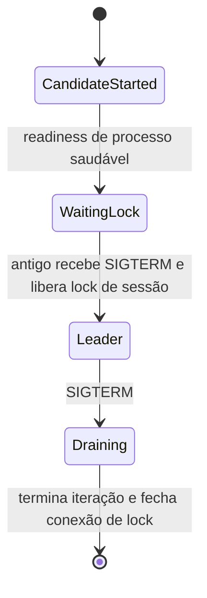

# AWS-006 — viabilidade e provas pendentes

Terraform 1.13.5 e AWS provider 6.69.1 fixados; o schema instalado foi inspecionado para `aws_ecs_service.deployment_configuration.strategy`, `bake_time_in_minutes`, `lifecycle_hook`, `load_balancer.advanced_configuration` e `aws_lb_listener_rule.transform.url_rewrite_config`. Suporte no schema não comprova execução em sa-east-1.

Usar ECS nativo BLUE_GREEN, bake de 10 minutos, hook Lambda no POST_TEST_TRAFFIC_SHIFT. O hook só retorna SUCCEEDED após smoke na revisão candidata; falha deve retornar FAILED e bloquear shift. Pendente implementar/integrar após contrato de rotas AWS-003 e ambiente isolado. Test listener sozinho não é aprovação. Prova real deve forçar smoke falho, mostrar tráfego público ainda azul, depois smoke aprovado e rollback por alarme durante bake. Hook e permissões/custo entram no plan e AWS-009; nenhuma Lambda foi criada.

Handover esperado:

O candidato aguardando lock precisa ser considerado saudável sem executar negócio; se readiness exigir liderança, ECS 100/200 não para o antigo e entra em deadlock. Perda de conexão de lock interrompe o trabalho antes de tentar readquirir. Provar com PostgreSQL real, dois processos, falha abrupta e SIGTERM dentro de 120s, e depois ECS na substituição do host. Implementação da aplicação permanece AWS-019, que não está neste lote azul.

ARM64 Linux/awsvpc para Fargate; 0,5vCPU/1GiB para API é combinação válida; EC2 bridge para os três contínuos com SG do host nos dados. Não adicionar NAT, SQS ou hosts duplicados por app. Scheduler retry trata chamada RunTask, não exit code do container: registrar task ARN, observar ECS Task State Change e heartbeat, distinguir falha de invocação, exit não zero e stalled. Quotas/RunTask/PassRole reais dependem AWS-008/009/027.

UAT off: S3 website não entrega HTTPS próprio para hostname UAT. Proposta pendente de Felipe: assumir indisponibilidade explícita enquanto desligado, ou cotar endpoint HTTPS persistente; não criar CloudFront/novo serviço nem registros DNS por inferência. Reservar QA/TestFlight/revisão das lojas com keep-until aprovado. DNS continua adiado.

Fontes oficiais: [ECS blue-green](https://docs.aws.amazon.com/AmazonECS/latest/developerguide/deployment-type-blue-green.html), [hooks e respostas](https://docs.aws.amazon.com/AmazonECS/latest/developerguide/lambda-lifecycle-hooks.html), [Terraform ECS service](https://registry.terraform.io/providers/hashicorp/aws/6.69.1/docs/resources/ecs_service), [Terraform S3 lock](https://developer.hashicorp.com/terraform/language/backend/s3), [lançamento em regiões comerciais](https://aws.amazon.com/about-aws/whats-new/2025/07/amazon-ecs-built-in-blue-green-deployments/).

Conclusão de preparo: mecanismo documentado e schema verificável; testes de tráfego/handover/ARM/quotas e decisão UAT HTTPS pendentes. AWS-006 permanece aberta.
